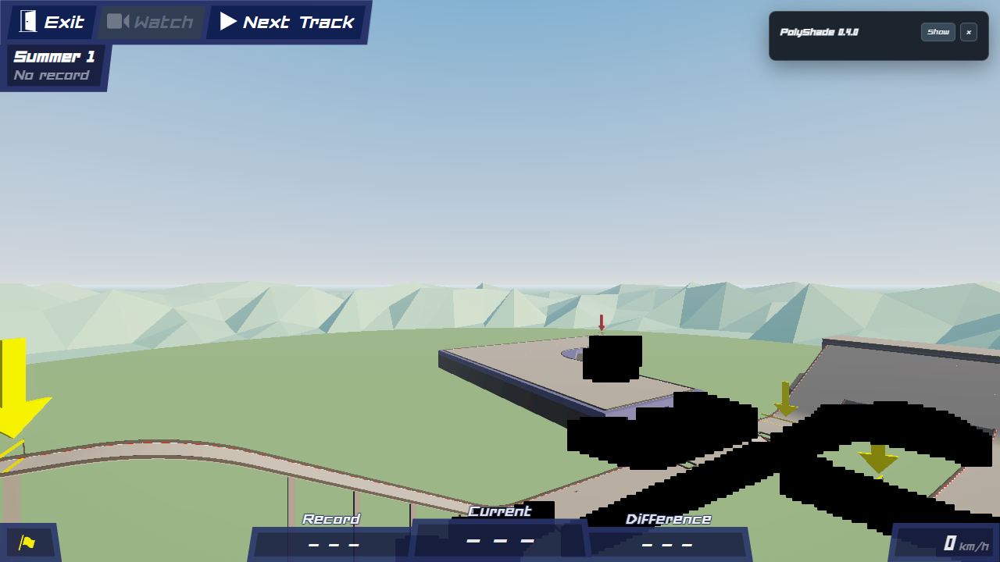
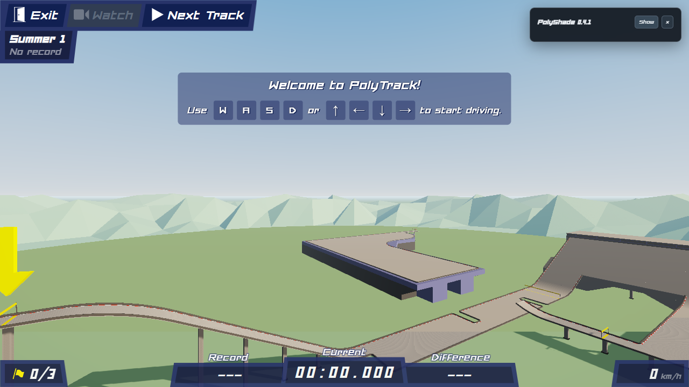
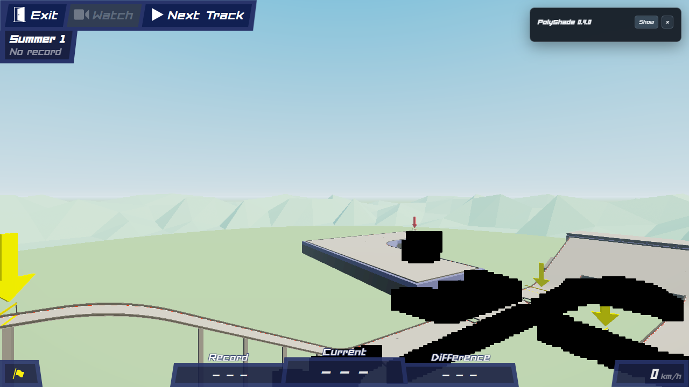
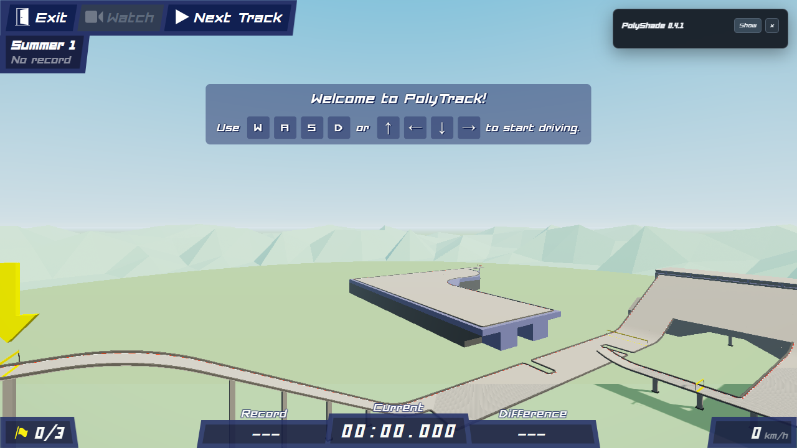
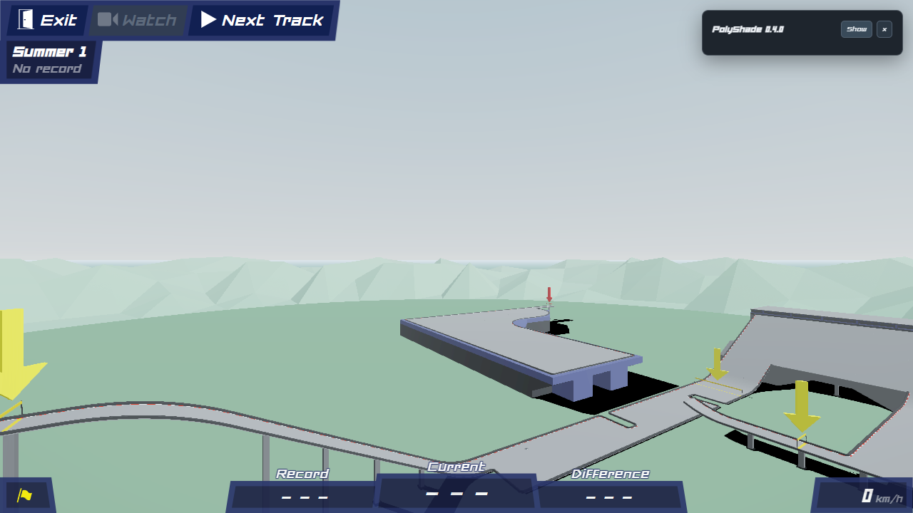
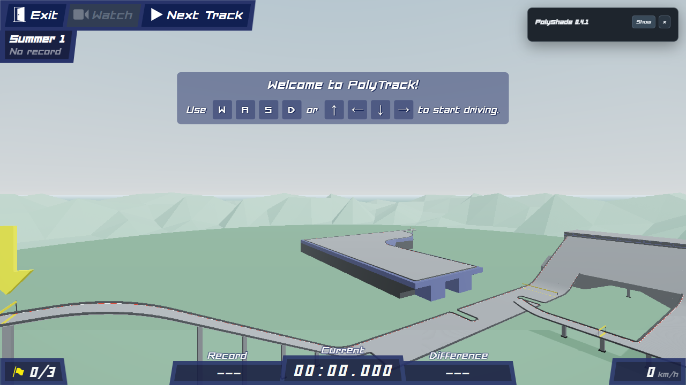

# PolyShade 0.4.1: matched presentation, WebGPU only

The current mod renders its enhanced scene, effects, SGSR2 and presentation exclusively with WebGPU. It no longer contains the active WebGL backend or Fragment upscaler. Three's automatic GL fallback is excluded from the bundle by constructing the common renderer with its GPU backend directly. A build regression check also rejects accidental inclusion of the fallback or a second bundled Three node system.

## Visual changes

- Preserve authored Phong shininess, reflectivity, normal scale and supported material maps; remove stale maps when the source changes.
- Keep the procedural sky outside world fog and scene tone mapping. Its final grading still uses the existing presentation controls.
- Match the reference AO radius, falloff, strength and sample counts, with separate horizontal/vertical depth-aware filtering. Reconstruct view positions at sampled depth-texel centres to prevent stripe patterns on smooth roads.
- Match bloom's max-channel threshold and colour-preserving extraction, followed by separate four-tap bloom blur passes.
- Smooth sun rays with the reference nine-tap composite.
- Use interpolated soft PCF shadows instead of widely separated taps that produce a grid around car shadows.

The scene remains stylized; this does not introduce photographic sky textures or a separate sun direction. Compute reconstruction, velocity, local history rejection and the grading controls remain intact.

## Paired captures

The [capture script](../scripts/verify-visual-match.mjs) uses the immutable 0.4.0 GL reference and 0.4.1 GPU renderer in separate fresh Edge profiles, sharing a frozen Summer 1 camera. Clouds and motion blur are disabled for this deterministic comparison. Four presets pass the sky-region comparison: mean absolute RGB channel difference is 0.15 to 0.20 on the 0 to 255 display scale. This is a sky measurement, not a whole-image similarity score.

| Reference 0.4.0 GL | Current 0.4.1 GPU |
| --- | --- |
|  |  |
|  |  |
|  |  |

The reference's distant black patches are not a visual target. Shadows use different cascades and filtering, so the complete frames are not pixel-identical. [A separate car view](verification/0.4.1/car-webgpu.png) checks contact shading and the improved shadow filter. Capture preset images and [raw comparison results](verification/0.4.1/visual-match.json) are also preserved.

## Verification

`npm run check`: 74 passing tests (including three historical fixture-module discovery checks), zero failures. Material parity, setting migration and release-bundle exclusion checks supplement existing temporal/resource/shadow tests.

`npm run verify:webgpu`: real NVIDIA Turing GPUDevice in Edge, actual compute dispatch, 100/77/67/59/50% scales, native-resolution output, all debug views, presets, resize and camera cuts. Normal frames with profiling disabled perform zero GPU readbacks. Moving-car disocclusion rejects newly revealed road locally; static marking variance is unchanged before/after rejection (0.00000240571). Synthetic swarm coverage includes 147 visible moving cars. Deliberate device destruction stops enhancement, displays a notice and never renders a GL fallback; Home restores native gameplay. The real Summer 2 #1 replay was available and captured in this run: [replay image](verification/0.4.1/summer2-replay.png). See [raw real-device results](verification/0.4.1/webgpu.json).

`npm run verify:visual`: four paired preset captures and sky-region assertions pass. Use `POLYSHADE_HEADED=1` to watch browser tests; reports and images are written under `%TEMP%`.

## Compatibility and boundaries

Saved Fragment settings migrate to Compute. Renderer-backend and GL multisampling controls are removed. Native, Reduced, Auto and Compute all select WebGPU; Compute failures may select native-resolution GPU rendering. Unsupported scene adapters or device failures stop enhancement with an explicit message rather than silently choosing GL.

PolyTrack itself still creates its native GL renderer for boot, utility/offscreen rendering and gameplay when the mod is disabled. The mod's CPU scene preparation still recognizes native materials, including shader descriptions converted by GPU adapters. Removing the game's own GL dependency requires changes to PolyTrack, beyond a mod renderer replacement. Historical bundles and test-only GL fixtures remain immutable references and are not imported by the release.

Known adapter limitations from 0.4.0 remain: arbitrary custom shaders, skinned meshes and compressed textures require dedicated adapters; independently moving transparent ghosts and moving instanced objects need extra motion support. Screen-space scattering cannot account for offscreen occluders. These checks do not establish that every reported black-box case or long gameplay freeze is eliminated.

## Current GPU-only timing sweep

Fresh Edge profile, NVIDIA T500/Turing, 1280 x 720 output, frozen offline Summer 1 start scene; motion blur off. Each case warms for two seconds and samples asynchronous GPU timings for five seconds. This is a fixed-view cost comparison, not measured gameplay FPS or a before/after optimization claim.

| Mode / scale | Scene GPU median ms | SGSR2 GPU median ms | Total GPU median ms |
| --- | ---: | ---: | ---: |
| native-100 | 0.852 | 0.000 | 2.556 |
| sgsr2-compute-100 | 0.655 | 1.376 | 3.736 |
| sgsr2-compute-77 | 0.459 | 1.114 | 2.687 |
| sgsr2-compute-67 | 0.328 | 1.049 | 2.228 |
| sgsr2-compute-59 | 0.328 | 0.983 | 2.032 |
| sgsr2-compute-50 | 0.197 | 0.918 | 1.769 |

Scene time includes shadows; total includes motion/effects/presentation. Independently sampled medians need not sum exactly. At 50%, Compute uses 30.8% less total GPU time than native in this captured view (2.556 to 1.769 ms); 77% and 100% cost more than native. Reconstruction overhead can exceed scene-rendering savings. This is not an improvement claim versus 0.4.0, whose capture is different. [Raw sweep](verification/0.4.1/benchmark.json) includes Reduced comparisons and resource/timing diagnostics. Prior 0.4.0 comparisons remain historical and use a different snapshot.
