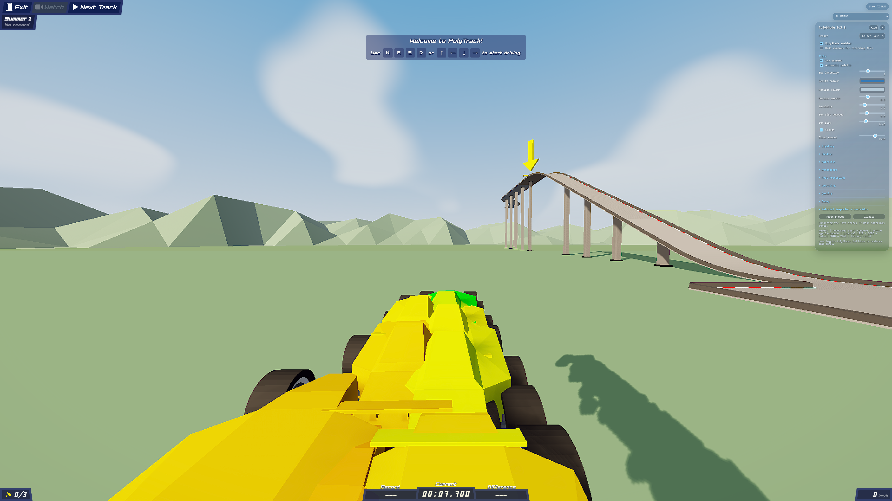
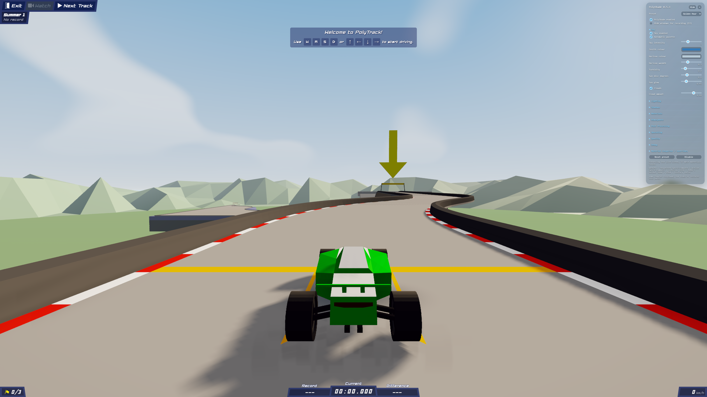
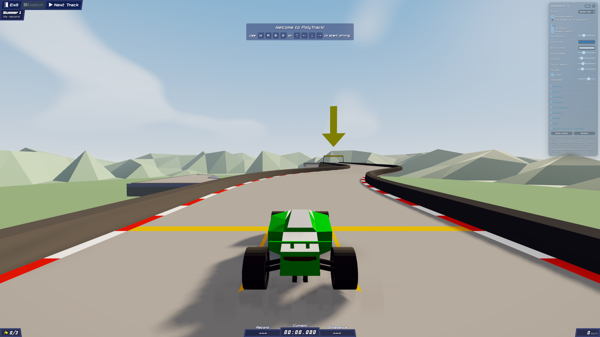

# PolyShade 0.5.4 — 4K performance pass

This release optimizes SGSR2 Compute while leaving the Golden Hour preset, render scales, replay interpolation, and swarm instance path unchanged. The 0.5.3 bundle remains available at its pinned release URL.

## Test system and method

- NVIDIA T500 (Turing, 4 GB dedicated VRAM), driver 573.91; Edge 155.0.4283.45; PolyTrack 0.6.3.
- The stray PolyTrack tab was closed before the clean reruns. Each case ran in its own headless Edge profile, and the profile closed after completion. PolyShade and PolyBot GPU timing was not run concurrently with the user's Edge tabs.
- Output was a real 3840×2160 canvas with device scale factor 1. Internal scene dimensions were checked against the requested scale. Golden Hour, WebGPU, all normal lighting, shadows, AO, bloom, rays, motion blur, and the existing SGSR2 filter were enabled.
- Fixed camera, three seconds warmup, ten seconds measured per graphics case. Timestamps were sampled asynchronously for the diagnostic run; normal debug sampling remains once per twelve frames. Frame interval and renderer CPU distributions use `performance.now()` samples. Numbers are medians, p95, and p99, in milliseconds. The 4K runs collected 40–62 GPU samples per case and 92–141 frame intervals.
- CPU and RAM use varied little during 4K GPU saturation: renderer CPU median was 2.5–3.2 ms. `nvidia-smi` reported 100% GPU utilization and approximately 810–885 MHz graphics clocks, with 50–53 °C during the paired final 4K run. Reported system free RAM was about 1.5–1.7 GiB of 11.7 GiB. Dedicated GPU memory readings were about 1.9–2.1 GiB for the whole Edge/GPU process; they are not attributable to PolyShade alone.

The first run made while a game tab was open is discarded. An initial swarm harness also opened an extra Edge instance; those early swarm figures are discarded too. The final swarm harness uses one isolated Edge instance, verifies its process tree is closed, and was rerun for every reported result below.

## What limited 4K

This is a GPU fill/compute limit on the T500, not the learner or main-thread CPU. With native rendering, GPU time rose from 5.83 ms at 1280×720 to 82.71 ms at 3840×2160. At 4K SGSR2 50%, the scene is 1920×1080, but the reconstruction still writes a 4K output and 4K temporal histories. SGSR2 Upscale was the largest individual pass, followed by scene rendering, grading, and conversion.

| Native Golden Hour output | Frame interval p50 / p95 / p99 | GPU work p50 / p95 / p99 | Renderer CPU p50 |
| --- | ---: | ---: | ---: |
| 1280×720 | 16.7 / 18.0 / 18.9 | 5.83 / 20.19 / 20.84 | 3.7 |
| 1920×1080 | 23.0 / 24.8 / 25.8 | 20.77 / 21.69 / 21.82 | 3.1 |
| 2560×1440 | 40.6 / 42.6 / 43.5 | 37.49 / 38.21 / 38.80 | 3.0 |
| 3840×2160 | 88.4 / 91.3 / 92.8 | 82.71 / 86.97 / 87.88 | 2.9 |

GPU work grows much faster than the roughly constant renderer CPU cost. This scaling shows why the T500 cannot reach 60 FPS at 4K with Golden Hour and SGSR2 enabled. Even the best 50% case remains around 70.5 ms median frame interval, about 14.2 frames/s by reciprocal-of-median interval; this is not an average-FPS claim.

## 4K before and after

`GPU total` is the sum of the timestamped passes. `Frame interval` is the actual browser render-loop gap, not GPU time. The final column isolates the pass changed by this release. SGSR2 is not active in Native.

| Internal scene | GPU total before → after (p50 / p95 / p99) | Frame interval before → after (p50 / p95 / p99) | SGSR2 Upscale p50 before → after |
| --- | ---: | ---: | ---: |
| Native 3840×2160 | 82.25 / 89.06 / 89.26 → 82.31 / 85.26 / 86.77 | 88.3 / 93.4 / 95.0 → 88.0 / 90.8 / 91.9 | — |
| 77% 2957×1663 | 106.23 / 108.27 / 108.99 → 101.97 / 103.55 / 103.81 | 108.5 / 111.2 / 113.8 → 105.6 / 109.7 / 114.2 | 43.25 → 40.30 |
| 67% 2573×1447 | 92.34 / 94.18 / 94.63 → 87.88 / 91.55 / 96.08 | 94.1 / 97.4 / 98.1 → 90.9 / 95.1 / 98.4 | 42.86 → 39.78 |
| 59% 2266×1274 | 82.77 / 85.13 / 86.51 → 78.51 / 80.22 / 85.85 | 83.7 / 87.2 / 107.5 → 80.9 / 83.9 / 85.7 | 42.27 → 39.06 |
| 50% 1920×1080 | 73.01 / 75.17 / 76.02 → 68.29 / 71.37 / 74.65 | 74.1 / 76.9 / 93.8 → 70.5 / 74.0 / 77.2 | 41.09 → 37.75 |

The 50–77% GPU-total p50 improvement is about 4–7%; the native path is unchanged. SGSR2 Upscale itself improves about 7–8%. Frame p95 improves at every reduced scale; p99 varies with occasional long browser/GPU scheduling gaps and has limited samples, so no claim is made that every p99 improved. The workgroup-size sweep did not help: 8×8 repeated at 81.33/81.20 ms total, 16×8 was 81.00 ms, 8×16 was 81.46 ms, and 16×16 was 82.05 ms in the separate 50% sweep. Those differences were within run noise or regressed, so the original 8×8 dispatch remains.

### Main pass costs at 4K / 50% scale

Pass time p50 / p95 / p99, milliseconds. Shadow maps were cached for this stationary-scene run, so no shadow-update pass appears here; moving swarm shadows are measured separately below.

| Pass | Before | After |
| --- | ---: | ---: |
| Main scene | 14.42 / 15.34 / 15.73 | 12.85 / 13.11 / 13.50 |
| Static velocity | 0.85 / 1.90 / 1.97 | 0.92 / 0.92 / 0.92 |
| AO evaluation | 1.25 / 1.31 / 2.29 | 1.31 / 1.38 / 1.38 |
| AO horizontal / vertical | 0.66 / 0.72 / 1.77; 0.66 / 0.72 / 1.84 | 0.66 / 0.72 / 0.72; 0.66 / 0.72 / 0.72 |
| Bloom | 0.26 / 0.26 / 0.33 | 0.26 / 0.33 / 0.33 |
| Sun rays | 0.72 / 0.79 / 1.84 | 0.72 / 0.79 / 0.79 |
| Colour grading | 3.54 / 4.78 / 4.85 | 3.74 / 3.87 / 3.93 |
| SGSR2 Convert | 4.65 / 5.44 / 5.70 | 4.85 / 5.83 / 12.65 |
| SGSR2 Upscale | 41.09 / 43.91 / 44.24 | 37.75 / 39.06 / 42.01 |
| Geometry history | 0.85 / 0.92 / 2.03 | 0.92 / 0.92 / 0.92 |
| Final presentation | 3.08 / 4.19 / 4.26 | 3.08 / 3.21 / 3.21 |
| **GPU total** | **73.01 / 75.17 / 76.02** | **68.29 / 71.37 / 74.65** |

## What changed

The SGSR2 upscaler now cooperatively caches the packed YCoCg source samples in workgroup memory. Neighboring output pixels previously fetched and decoded overlapping 3×3 source neighborhoods independently. An 8×8 output workgroup needs at most a 10×10 source tile at the supported ratios. The shader reuses those decoded values, but preserves the original sample coordinates, clamping, 5/9 sample selection, weights, clip/variance math, temporal history, and accumulation order. No replay data, car geometry, render scale, output resolution, or effect setting changes.

The cache uses about 1.6 KiB of workgroup memory per dispatch group; it adds no persistent texture or global GPU-memory allocation. The timestamp profiler has a configurable sampling interval for dedicated measurements, with the normal runtime default still 12 frames. Mapping query results remains asynchronous and is disabled when debug profiling is off.

## Render targets and memory

Logical owned-texture estimates include PolyShade's persistent targets, the scene colour/depth attachment, one 4-byte output surface, and three 2048×2048 shadow maps with depth. They exclude driver allocations, browser swapchain buffering beyond one image, game geometry, and caches; `nvidia-smi` is reported separately. The reported estimates are the same before and after: the cache is workgroup-local, so VRAM reduction is **0 MiB**.

| 4K output mode | Estimated owned textures |
| --- | ---: |
| Native | 454.0 MiB |
| SGSR2 77% | 624.3 MiB |
| SGSR2 67% | 550.3 MiB |
| SGSR2 59% | 498.4 MiB |
| SGSR2 50% | 448.0 MiB |

At 50%, the full-size SGSR2 attachments remain: two 3840×2160 RGBA16F histories and one 3840×2160 RGBA16F output. The output is intentionally full resolution; the scene and effects scale to 1920×1080. No resource pool growth occurs during a steady-size run; changing scales resizes/replaces same-named targets. The native scene target uses 0 MSAA samples; render targets and shadow maps also report 0 samples.

For the 50% case, WebGPU texture usage `20` means sampled + render attachment; `12` means sampled + storage. Each target below is single-sampled. Writes and reads are per-pass attachment/sample uses, not per-pixel fetch counts.

| Target | Size / format / bytes per pixel | Usage | Writes per frame | Read passes per frame |
| --- | --- | --- | --- | --- |
| Scene colour | 1920×1080 RGBA16F / 8 B | 20 | Scene: 1 | Bloom, grade, SGSR2 Convert |
| Scene depth | 1920×1080 Depth32F / 4 B | scene attachment | Scene: 1 | Velocity, AO, sun visibility/mask, grade, Convert, geometry history |
| Velocity | 1920×1080 RGBA16F / 8 B | 20 | Static velocity + motion: 2 | Grade, Convert, geometry history |
| AO raw | 960×540 RGBA16F / 8 B | 20 | AO + vertical blur: 2 | Horizontal blur, grade |
| AO intermediate | 960×540 RGBA16F / 8 B | 20 | Horizontal blur: 1 | Vertical blur |
| Bloom raw | 480×270 RGBA16F / 8 B | 20 | Threshold + wide blur: 2 | First blur, wide blur |
| Bloom intermediate | 480×270 RGBA16F / 8 B | 20 | First blur: 1 | Wide blur |
| Sun mask | 512×512 RGBA16F / 8 B | 20 | Sun-mask pass: 1 | Rays |
| Rays | 1920×1080 RGBA16F / 8 B | 20 | Rays: 1 | Grade (10 spatial taps when enabled) |
| Graded | 1920×1080 RGBA16F / 8 B | 20 | Grade: 1 | SGSR2 Convert |
| SGSR2 converted | 1920×1080 RGBA16F / 8 B | 12 | Convert: 1 | Upscale |
| SGSR2 packed YCoCg | 1920×1080 R32Uint / 4 B | 12 | Convert: 1 | Upscale source tile; cached once per tile |
| SGSR2 rejection | 1920×1080 R32Float / 4 B | 12 | Convert: 1 | Upscale |
| SGSR2 geometry | 1920×1080 RGBA16F / 8 B | 20 | Geometry history: 1 | Next-frame Convert |
| SGSR2 histories A/B | 3840×2160 RGBA16F / 8 B each | 12 | Upscale writes one ping target | Upscale reads the other; roles alternate |
| SGSR2 output | 3840×2160 RGBA16F / 8 B | 12 | Upscale: 1 | Final presentation |
| Shadow maps | 3 × 2048×2048 RGBA8 + Depth32F / 8 B effective | render attachment | Shadow update when dirty; moving swarm updates | Main scene lighting |
| Output surface | 3840×2160 BGRA8 / 4 B estimated | browser surface | Final presentation: 1 | Browser compositor |

The workgroup-size sweep found no faster dispatch. The SGSR2 4K reads/writes remain the main cost; no format was narrowed, no fullscreen pass was disabled or fused, and no lower-resolution effect was introduced.

## PolyBot replay-swarm check

This matrix uses complete replays exported by PolyBot's replay-selection flow, then loads them into a fresh local PolyTrack instance with no trainer or bridge. The 1, 100, and 500 car cases are renderer-only, Golden Hour, actual 4K output, SGSR2 50/67, one lead-camera run, normal playback, and 12 seconds of frame sampling. At all counts the shared PolyShade source stayed at **11 material-group draws**; uploaded instance data was 0–0.8 ms, rather than a per-car draw or object update. The 500-car source includes 1,551,000 triangles and a 104.8 MB instance allocation. Replay timing and physics are not called from the new SGSR2 cache.

| Cars | Scale | GPU total p50 before → after | SGSR2 Upscale p50 before → after | Frame interval p50 before → after | Shadow pass after | Upload after |
| ---: | ---: | ---: | ---: | ---: | ---: | ---: |
| 1 | 50% | 68.0 → 64.2 ms | 39.1 → 36.4 ms | 66.8 → 66.7 ms | 0.2 ms | 0.0 ms |
| 100 | 50% | 76.5 → 69.1 ms | 40.0 → 36.9 ms | 83.2 → 83.1 ms | 2.8 ms | 0.2 ms |
| 500 | 50% | 93.3 → 89.7 ms | 40.4 → 36.6 ms | 99.9 → 99.9 ms | 19.7 ms | 0.5 ms |
| 1 | 67% | 77.1 → 86.9 ms | 41.3 → 38.7 ms | 83.5 → 83.5 ms | 0.2 ms | 0.0 ms |
| 100 | 67% | 93.3 → 91.1 ms | 41.5 → 38.4 ms | 100.0 → 100.0 ms | 2.8 ms | 0.1 ms |
| 500 | 67% | 115.6 → 111.0 ms | 41.5 → 38.3 ms | 116.7 → 116.7 ms | 20.0 ms | 0.8 ms |

The low-count 67% total varies with the 4K output pass mix and browser frame scheduling; its renderer-loop interval did not improve. At 500 cars, the dominant additional work is the scene and live shadow update (about 11–17 ms scene and 20 ms shadows), not per-instance CPU uploads. 500 cars do not reach 60 FPS on this T500. A live 500-car capture is included below; the swarm naturally bunches where the selected training runs share the same track section.

## Paired 4K captures

Before and after use the same 4K browser viewport and saved camera. The remaining difference comes from separate SGSR2 temporal-jitter phases and capture timing; no meaningful loss was visible in track edges, car silhouette, shadows, AO, bloom, rays, or sky. Raw 4K PNGs are included for inspection.

| Native before | Native after |
| --- | --- |
|  |  |

| SGSR2 50% before | SGSR2 50% after |
| --- | --- |
|  |  |

The screenshot channel mean absolute errors were 0.084/255 (Native) and 0.172/255 (SGSR2 50%). Over 99.5% of 50% screenshot channels differed by at most 2/255. These images are captured after the standard warmup and should be reviewed at original 3840×2160 resolution.

## Verification

- `npm run check` — release bundle built; all 94 Node tests passed, including the workgroup-cache bounds regression test.
- `npm run verify:webgpu` — compute-kernel and real-device WebGPU/temporal/lifecycle checks passed; `errors: []`. The printed `Device was destroyed` is the expected explicit device-loss case.
- `npm run verify:visual` — all preset captures completed; sky mean absolute error stayed 0.15–0.20/255 across the existing WebGL reference comparison.
- `npm run verify:upscaling` — all Native/Reduced/SGSR2 scale cases completed at 1280×720; this is a separate low-resolution benchmark.
- `npm run verify:4k` — all five Golden Hour scales completed with true 3840×2160 output and no browser/WebGPU errors.
- `npm run profile:swarm` — clean local PolyBot 1/100/500 replay-swarm profiles run manually at both 50% and 67%, with no trainer/bridge.

The T500's remaining limit is GPU work: at 4K the renderer is still around 11–14 FPS by median frame interval, depending on scale. 50% gives the best speed, but falls far short of 60 FPS. Lowering the preset/effects or changing the SGSR2 algorithm would be required for a much larger increase; this release makes no such trade.
